<picture>
  <source media="(prefers-color-scheme: dark)" srcset="branding/public/svg/logo-horizontal-dark.svg">
  
</picture>

# Stedding Browser

**An open-source, Arc-style web browser built on Chromium.** A sidebar with vertical tabs,
Spaces, folders and pinned tabs, a command bar, and one-click import from Arc on the Mac.
macOS (Apple silicon) and Windows. No telemetry. BSD-3-Clause.

[](https://github.com/ysalitrynskyi/stedding-browser/releases)
[](LICENSE)


[stedding.dev](https://stedding.dev) · [Download](#download) ·
[What it adds](#what-stedding-adds-to-chrome) · [Tour](#a-tour) ·
[Shortcuts](#keyboard-shortcuts) · [Moving from Arc](#moving-from-arc) · [Privacy](#privacy) ·
[FAQ](#faq) · [Build](#building-from-source) · [Docs](#documentation)


## What Stedding adds to Chrome

Under it all is Chromium, kept close to Google's own: the same engine, the same
DevTools, and extensions from the Chrome Web Store that work as they do in Chrome. On
top of it, everything below. Each item links to its specification, which says what is
built and names the test behind each behaviour. (Mac) marks what only the macOS build
has so far. The keys are the Mac's; [docs/SHORTCUTS.md](docs/SHORTCUTS.md) has the
Windows ones beside them.

**The window**
- **The address row in the page's colour.** The row is the top edge of the page card and takes the colour each page draws along its top, with the address centred. [Spec](docs/features/toolbar.md)
- **Light and dark.** Sand by day, a blue-to-plum gradient by night, following the system or your choice. [Spec](docs/UI-SPEC.md)
- **The page flush against the window**, if you like: no margin or rounded corners round it (Settings → Stedding → Sidebar). [Spec](docs/features/sidebar.md)
- **Private windows in a coat of their own**: graphite, with "Private" at the head of the sidebar. [Spec](docs/features/private.md)
- **Dark pages** (next release). One moon button by the address row, or ⌥⇧⌘D, turns every website dark with Chromium's own automatic dark mode, from the first frame, so there is no white flash; the sites you keep light, or the only ones you darken, are listed in Settings. [Spec](docs/features/dark-pages.md)

**Sidebar and tabs**
- **Vertical tabs at Arc's proportions**, with three row heights and a text size. [Spec](docs/features/sidebar.md)
- **Essentials**: the sites you use everywhere, as cards above every Space. [Spec](docs/features/pins.md)
- **Pinned tabs that remember their page.** Wander off and a slash says so; ⌥-click the icon or middle-click the row to go back; ⌘W puts a pin to sleep instead of closing it. [Spec](docs/features/pins.md)
- **Folders**, nested, collapsible and renamed in place, with New Tab in Folder, Alphabetize, and ⇧⌘E for all of a Space's folders at once. [Spec](docs/features/folders.md)
- **The rail, or no sidebar at all.** ⌘S folds the sidebar to a column of icons, or hides it completely; the window's edge brings it back. [Spec](docs/features/sidebar.md)
- **Clear and Undo.** ⇧⌘K or the Clear line closes a Space's loose tabs and keeps its pins and folders; the toast's Undo brings back any close. [Spec](docs/features/spaces.md)
- **A quieter foot** (next release). The Archived row and the Clear line sit back in a softer shade until the pointer reaches them. [Spec](docs/features/sidebar.md)
- **Rename any tab**, act on several selected rows at once, and hold ⌘ to number the rows for ⌘1–⌘9. [Spec](docs/features/tabs.md)
- **Sleeping tabs**, and Spaces that go to sleep a while after you leave them (off until you choose). [Spec](docs/features/tabs.md)
- **Recent tabs on ⌃⇥**: a tap goes back to the last tab, a hold shows the Space's five most recent. [Spec](docs/features/switcher.md)
- **The sidebar's edge** shows where to drag it, a double click there resets its width, and a middle click on empty ground opens the command bar. [Spec](docs/features/sidebar.md)
- **Local development tabs** (next release). A tab on your own machine's server wears Arc's dashed yellow outline while it is the active tab, with its host and port under its title, and a localhost page always keeps the address row. [Spec](docs/features/local-tabs.md)

**Spaces**
- **Spaces with a colour and an icon**, each tinting the sidebar; switch with the chips, ⌃1–⌃9, ⌥⌘←/→, or a two-finger swipe across the sidebar (Mac). [Spec](docs/features/spaces.md)
- **Independent sessions.** A Space can keep its own cookies and site data, so one site can be signed into twice in one window; Clear Independent Session signs that Space out at once. [Spec](docs/features/sessions.md)
- **A mark on a Space with its own session** (next release), on its chip and at the head of its tabs, so you always know which session you are in. [Spec](docs/features/sessions.md)
- **Routing**: a site always opens in the Space it belongs to, with a toast that undoes it. [Spec](docs/features/routing.md)
- **One sidebar for every window**, and New Blank Window (⌥⇧⌘N) for a window with Spaces of its own. [Spec](docs/features/windows.md)
- **Focus This Space and Hide Other Spaces**, from the command bar, for a quiet window or a shared screen. [Spec](docs/features/focus.md)

**The command bar**
- **⌘T for everything**: a URL, a search, or any open or archived tab in any Space; it completes a site from your history as you type. [Spec](docs/features/commandbar.md)
- **Site Search and Space filters**: ⇥ after a site's name searches that site, and `@Work` lists only the tabs of the Spaces whose name starts with "Work". [Spec](docs/features/commandbar.md)
- **Actions mode** (⇧⌘P, or `>`): the commands with their shortcuts, on and off rows for most settings, Close Duplicate Tabs, Clear Site Cookies and Reload (⌥⇧⌘R), and a blank Google Doc, Notion page, Figma file or GitHub repository in one step. [Spec](docs/features/commandbar.md)

**Pages and apps**
- **Split view**: ⌃⌘N or ⌥⌘N splits the tab with a new one; the panes move, pin and sleep together. [Spec](docs/features/splits.md)
- **Copy the link** without its tracking parameters (⇧⌘C), or as Markdown (⌥⇧⌘C). [Spec](docs/features/copy-link.md)
- **Screenshots by key**: the page as shown, a region, or the whole document, as a PNG in Downloads and on the clipboard. [Spec](docs/features/screenshot.md)
- **Sound and video by key**: ⌃M mutes the tab, ⌥⇧⌘P plays its video in picture in picture. [Spec](docs/features/player.md)
- **The archive.** Tabs nobody has looked at for a time you choose (off until you do) move to an Archived page, searchable by day and Space; Restore puts a tab back in its Space and folder. [Spec](docs/features/archive.md)
- **Little windows** (Mac): a link from another app opens in a small window of its own, and ⌘O moves the page into your window. [Spec](docs/features/little.md)
- **Apps from pages** (next release). Make any page an app, as Safari's Add to Dock does: it opens in a window of its own, keeps the session of the Space it was made in, and has its own tile in the Dock on the Mac. [Spec](docs/features/web-apps.md)

**Moving in, settings and updates**
- **Arc in one click** (Mac): Spaces with their colours and icons, essentials, pinned tabs, nested folders, open tabs, history and passwords. [Spec](docs/features/import.md)
- **Other browsers and files**: Chromium's importer for Safari and Firefox, a Space exported as a file, and a sidebar file imported. [Spec](docs/features/import.md)
- **A six-step welcome**: the search engine, import, appearance, how Stedding behaves, the default browser, and the keys worth knowing. [Spec](docs/features/welcome.md)
- **Arc's keyboard on both platforms**, with the full list in Settings → Stedding → Shortcuts. [Spec](docs/features/shortcuts.md)
- **A Stedding section first in Settings**, one switch per feature; Chromium's Google and AI sections are gone. [Spec](docs/features/settings.md)
- **Private by default**: no telemetry, third-party cookies blocked, HTTPS-First, Global Privacy Control, quiet permission prompts, search suggestions off. [Spec](docs/features/privacy.md)
- **Updates in the sidebar** (Mac): once a day Stedding looks for a new version, and New Stedding Version Available at the foot of the sidebar restarts into it. [Spec](docs/features/updates.md)

## What is Stedding?

Stedding is a desktop browser for people who liked the way Arc worked: tabs live in a
sidebar, each project or part of your life gets its own **Space**, the important sites
are **pinned** and always where you left them, and **⌘T** is one place to search,
open a site or jump to any tab. Arc stopped getting new features in 2025; Stedding
rebuilds that way of working on ground you control.

- **Open source, all of it.** The browser, its interface and the build are BSD-3-Clause
  licensed. No account, no company roadmap, nothing that can be taken away.
- **Built on Chromium stable** as a small, documented patch series, so it keeps up with
  Chromium's security releases and runs the extensions you already use.
- **Private by default.** No telemetry, no experiments, no Google sign-in or AI
  surfaces, third-party cookies blocked, the search engine of your choice
  (DuckDuckGo until you choose).
- **Made for technical users** who want a modern, keyboard-driven browser without
  trusting anyone's servers.

## Download

The current release is **0.2.0 beta 17**, built on Chromium 156.0.8078.36 (stable): a macOS
image for Apple silicon, signed and notarized, and a Windows preview. Get them from
[stedding.dev](https://stedding.dev/#download) or the
[Releases page](https://github.com/ysalitrynskyi/stedding-browser/releases):

| Platform | File | Notes |
|---|---|---|
| macOS, Apple silicon (M1 or later), macOS 13 or later | `Stedding-<version>-arm64.dmg` | Open the DMG, drag **Stedding** to Applications and open it: the image is signed and notarized ([details](docs/INSTALL.md#macos-apple-silicon)). |
| Windows 10 / 11, x64 | `Stedding-<version>-win-x64.exe` | Installs for the current user, no administrator prompt. If SmartScreen appears: **More info → Run anyway**, once. |

The Windows installer is **not yet code-signed**, which is why SmartScreen asks once; the
macOS image is signed and notarized. A SHA-256 checksum for each file is in the release notes; the
[install guide](docs/INSTALL.md) shows how to verify it, where your data lives, and how
to update or uninstall.

Not available yet: Intel Macs and Linux. See [Status and roadmap](#status-and-roadmap).

**New in beta 17:** Stedding moves to Chromium 156, and it is the first release that reaches
Macs by itself: beta 16 finds it within a day and offers it at the bottom of the sidebar. On
Windows the Archived row's text loses the colour fringes it had. Every release's changes
are in [the release notes](docs/release-notes/).

## A tour

Every picture here, and the animation at the top, was taken by the project's own
tooling ([tooling/readme/](tooling/readme/)) on 2026-10-19, from a signed build of the
tree after beta 17 that holds the next release's features, on profiles made for the purpose; the
Windows picture is beta 5's.

**The window.** Tabs in a sidebar on the left, the essentials as cards at the top, the
Space's pinned tabs, its folders and its tabs below them, and the page on a card of its
own. The address row is the top edge of that card, in the page's colour.

<picture>
  <source media="(prefers-color-scheme: dark)" srcset="docs/images/readme/hero-dark.png">
  
</picture>

**Spaces.** Each Space is a set of tabs with its own colour, icon and pinned sites.
Switch with the chips at the bottom of the sidebar, with ⌃1–⌃9, or, on a Mac, with a
two-finger swipe across the sidebar. A Space can put its tabs to sleep once you leave it
(a setting, off by default); sites can be routed so they always open in the right Space.
Turn on **Independent session** on a Space (chip menu, or Settings → Stedding → Spaces)
and that Space keeps its own cookies: you can be signed into the same site with a
different account in another Space. Essentials stay shared. Off by default. **Clear
Independent Session** on the chip menu signs that Space out of everything at once.

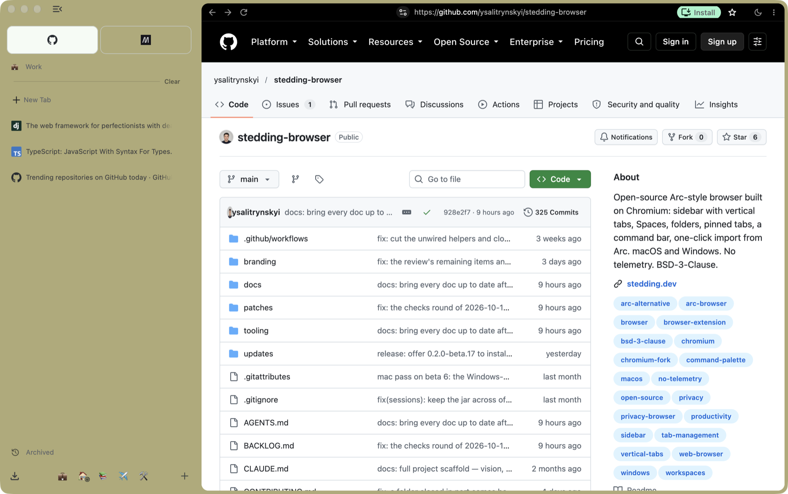

In the next release, a Space with its own session carries a mark, so you can tell at a glance which
session a tab is in.

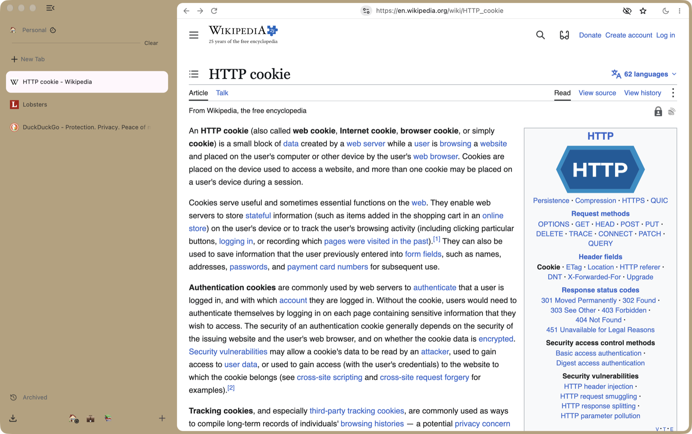

**The command bar.** ⌘T opens one bar for everything: type a URL, a search, or the name
of any open tab in any Space and jump to it. It completes a site from your history as you
type, and ⇥ after a site's name searches that site. Type `>` (or ⇧⌘P) for the commands,
each with its shortcut.

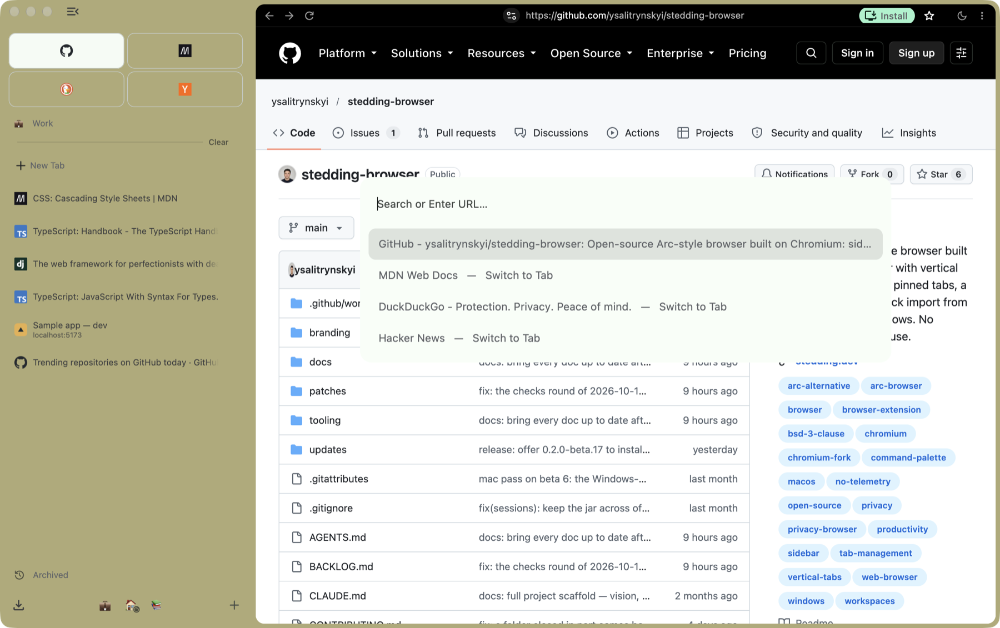

**Folders and pinned tabs.** Drag tabs into folders, nest folders, collapse them, rename
anything in place. A pinned tab remembers its home page: wander away and a slash shows
it; ⌥-click the favicon, middle-click the row, or choose **Reset to Pinned Page**, and
you are back.

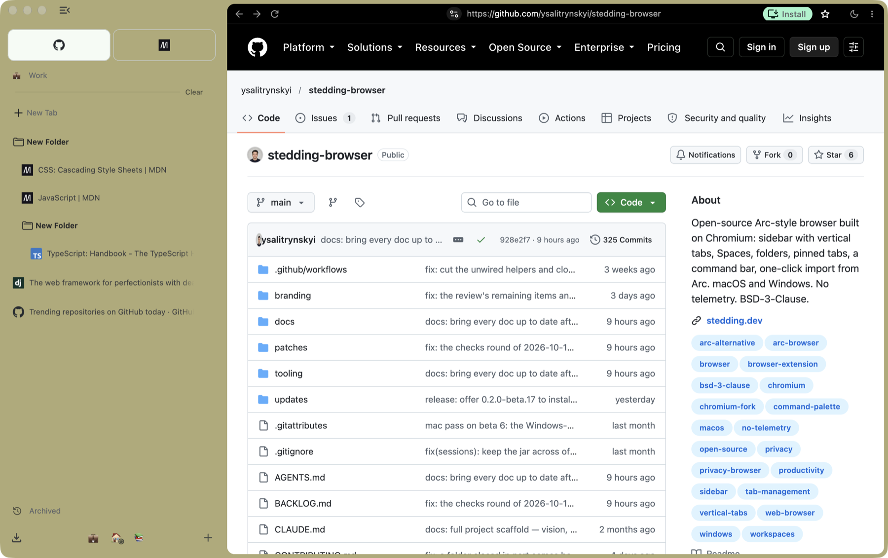

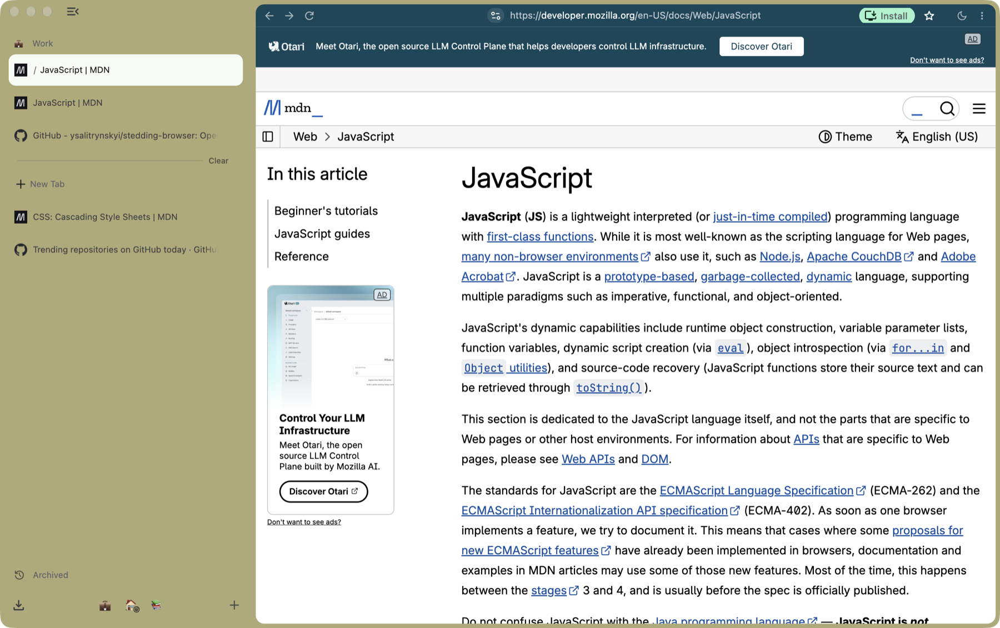

**The rail, or nothing at all.** ⌘S collapses the sidebar to a column of icons; hover to
peek at it. Or set it to hide completely (Settings → Stedding → Sidebar): ⌘S then gives
the page the whole window, edge to edge, and the pointer at the window's left edge slides
the sidebar back over it. The address row stays; a setting hides it with the sidebar, and
⇧⌘D shows or hides it on its own.

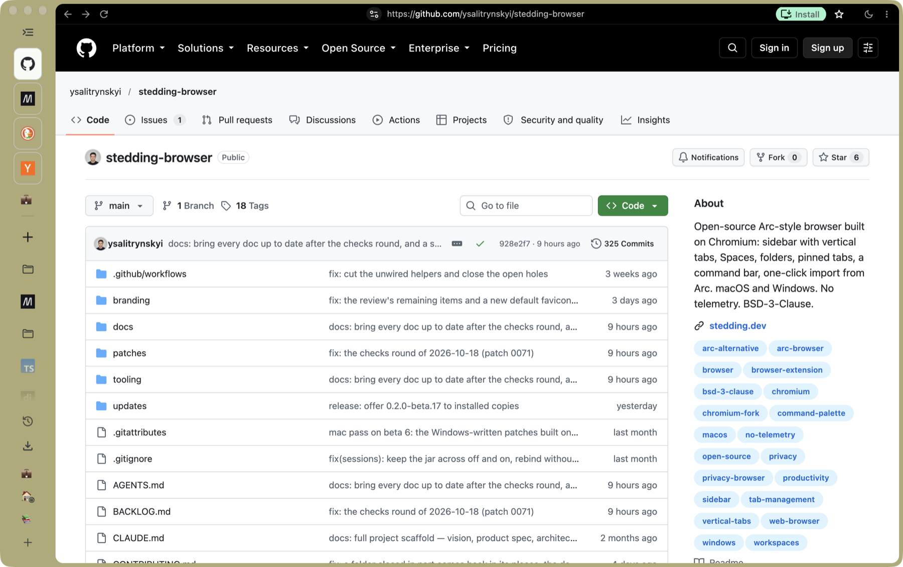

**Local development tabs** (next release). A page served from your own machine is marked in the
sidebar the way Arc marks it, with a dashed yellow outline while it is the active tab and its
host and port under its title; a localhost page always keeps the address row.


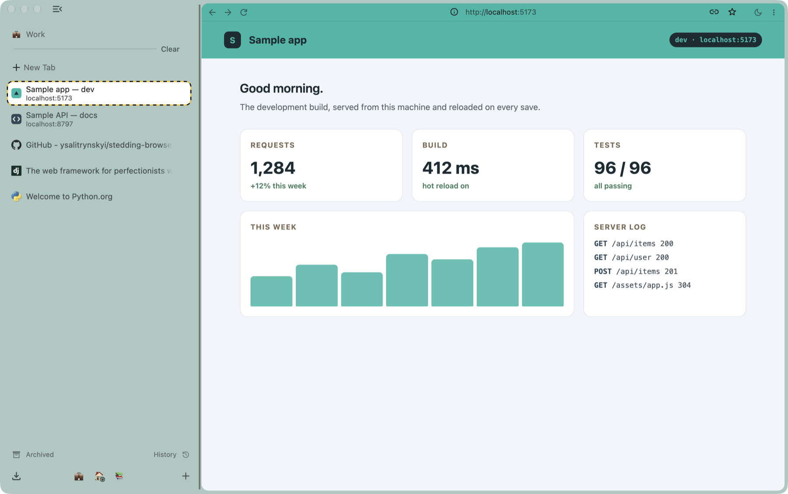

**Dark pages** (next release). The moon by the address row, or ⌥⇧⌘D, turns every website dark at once,
with Chromium's own automatic dark mode: the page is dark from its first frame, with no
white flash. Keep a site light from the page's menu; the list is in Settings.


**Apps from pages** (next release). Any page can become an app of its own, as Safari's Add to Dock
makes one: a window without the sidebar, its own tile in the Dock, and the cookies of
the Space it was made in, so an app made in a Space with its own session stays signed in
as that Space is.


**Light and dark.** Sand by day, a blue-to-plum gradient by night, following the
system or your choice; each Space's colour tints the sidebar.

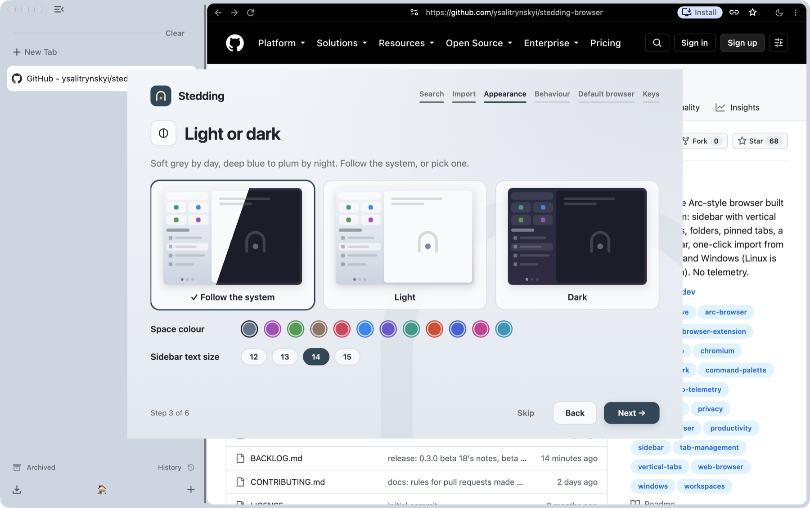

**Private windows** wear a different coat so you always know where you are.

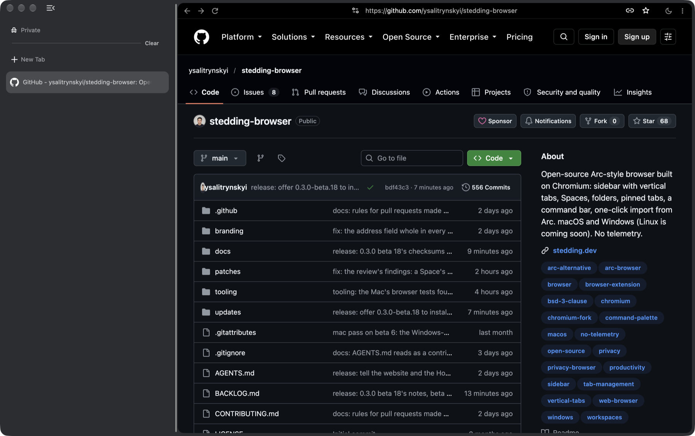

**Windows.** The same browser on Windows, with the address row under the window's own
buttons and Arc's keyboard mapped to Ctrl and Alt.


## Keyboard shortcuts

The most used ones. The complete list, for both platforms, is in
[docs/SHORTCUTS.md](docs/SHORTCUTS.md) and inside the browser at
**Settings → Stedding → Shortcuts**.

| Action | macOS | Windows |
|---|---|---|
| Command bar: search, a URL, any open tab | ⌘T | Ctrl+T |
| The commands, each with its shortcut | ⇧⌘P (or ⇥ in the empty bar) | Ctrl+Shift+P |
| Collapse or expand the sidebar | ⌘S | Ctrl+S |
| Show or hide the address row | ⇧⌘D | Ctrl+Shift+D |
| Pin the tab in its Space | ⌘D | Ctrl+D |
| Jump to Space 1–9 | ⌃1–⌃9 | Alt+1–9 |
| Next / previous Space | ⌥⌘→ / ⌥⌘← | Ctrl+Alt+→ / ← |
| Move the tab to the next / previous Space | ⌥⇧⌘→ / ⌥⇧⌘← | Ctrl+Alt+Shift+→ / ← |
| Jump to one of the first eight rows, or the last with 9 | ⌘1–⌘9 | Ctrl+1–9 |
| Most recent tab of the Space | ⌃⇥ | Ctrl+Tab |
| Clear the Space's unpinned tabs | ⇧⌘K | Ctrl+Shift+K |
| Collapse the Space's folders, or expand them all | ⇧⌘E | Ctrl+Shift+E |
| Mute the tab or unmute it | ⌃M | Ctrl+M |
| Reopen closed tabs, one at a time | ⇧⌘T | Ctrl+Shift+T |
| Split the tab with a new one | ⌃⌘N or ⌥⌘N | Alt+Shift+N |
| Turn dark pages on or off | ⌥⇧⌘D | Ctrl+Alt+Shift+D |
| Copy the link (clean) / as Markdown | ⇧⌘C / ⌥⇧⌘C | Ctrl+Shift+C / Ctrl+Alt+Shift+C |
| Screenshot: page / region / full page | ⇧⌘2 / ⌥⇧⌘2 / ⇧⌘1 | Ctrl+Shift+2 / Ctrl+Alt+Shift+2 / Ctrl+Shift+1 |
| New blank window (its own Spaces) | ⌥⇧⌘N | Ctrl+Alt+Shift+N |

Where Stedding rebinds a Chromium key, the old command keeps its menu item: Save Page
As is ⇧⌘S (Ctrl+Shift+S), the system print dialog on Windows is Ctrl+Alt+P.

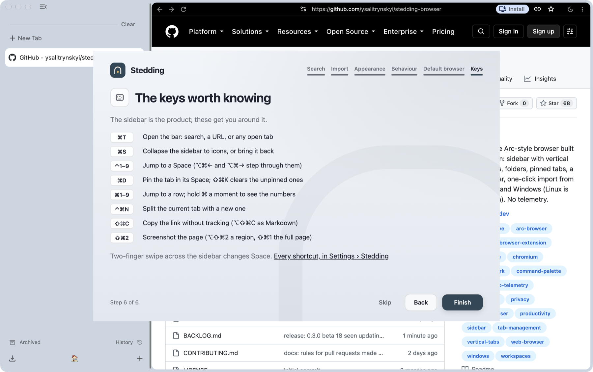

## Moving from Arc

On a Mac with Arc installed, the first start offers **Move everything from Arc**: your Spaces
with their colours and icons, the essentials row, pinned tabs, folders (nested), open
tabs, browsing history and saved passwords. Each is a checkbox, all checked by default.

- Nothing leaves your machine: the importer reads Arc's own files on disk.
- Passwords need one macOS keychain prompt, because that is where Arc keeps its key.
- Imported tabs are created asleep, so a big sidebar costs nothing until you open one.
- You can run it again later from **Settings → Stedding → Spaces → Import from Arc** or
  from the command bar; a second run never duplicates what is already there.
- On Windows, Stedding does not read Arc's files yet (`S-81`).

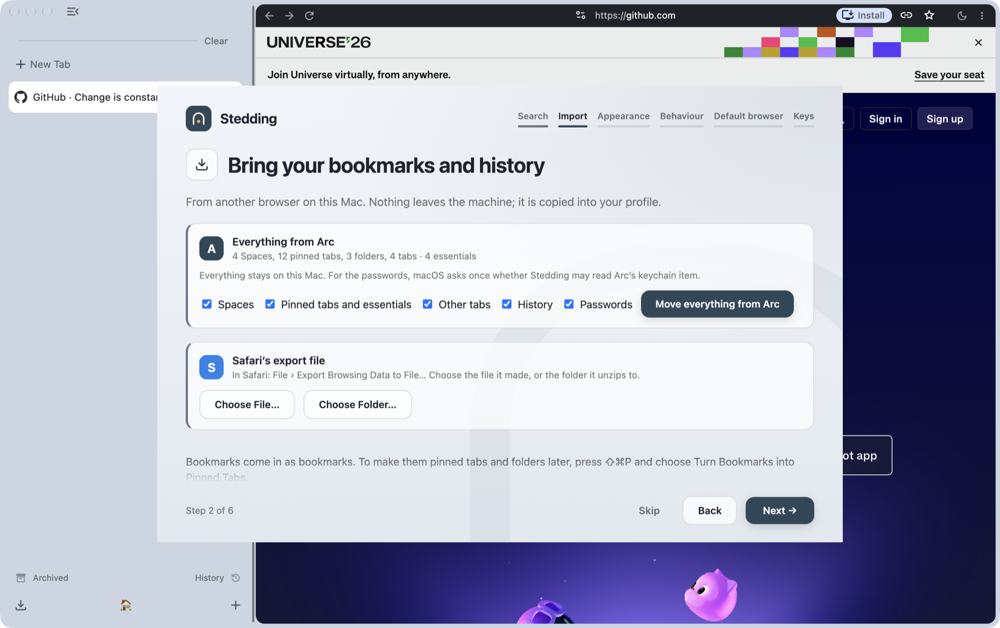

Coming from Safari or Firefox? The same step runs Chromium's own importer: on macOS,
Safari's bookmarks and Firefox's bookmarks and history; on Windows, Firefox (with
passwords), Internet Explorer and the old Edge. Chrome, Brave and the new Edge are not
supported yet. Imported bookmarks stay bookmarks; ⇧⌘P → **Turn Bookmarks into Pinned
Tabs** makes them pins. A Space can be exported as a file and a sidebar file imported;
there is no automatic backup.

## Privacy

Privacy here is a set of defaults, not a mode. Out of the box:

- **No telemetry, no experiments.** No usage metrics, no crash reports, no unique
  identifiers, no field trials. The new tab page is local and makes no requests.
- **No Google account surfaces.** No sign-in, no Google services in the omnibox, no AI
  sections in Settings. You pick the search engine at first start (DuckDuckGo until
  you do); search suggestions are off until you turn them on.
- **Protective defaults on:** third-party cookies blocked, HTTPS-first, Global
  Privacy Control sent, quiet permission prompts, Chromium's ad-measurement APIs off.
  Ad and tracker blocking built in is planned (`S-88`); until then an extension does it.
- **Private windows** in their own colours, with the same defaults.
- **Safe Browsing does not protect you in these builds:** its list updates need a Google
  API key the builds do not carry, so they are refused (`S-75`).

[docs/PRIVACY.md](docs/PRIVACY.md) lists the network connections the browser makes and
records what a fresh profile actually contacted; two Google calls on the earlier
record stopped with beta 15 (`S-54`, `S-67`), and anything else not on the list is a bug we
want to hear about. On the Mac, from beta 16 on, Stedding updates itself from GitHub once a
day (off in Settings); on Windows new versions appear on the Releases page.

## Status and roadmap

Stedding is an early **beta**. A review of the whole code in September 2026 found many
defects, some of them in the basics (selecting a tab, the collapsed sidebar, restoring a
session); the betas since then carry the fixes so far, and `BACKLOG.md` lists the rest. What is out
and what comes next:

| | State |
|---|---|
| macOS (Apple silicon) | Beta releases since 2026-09-01; the current image is beta 17's, signed and notarized as every macOS image is from beta 10 on; the Mac adds its image of a newer beta after its own pass |
| Windows x64 | Preview installer since beta 5, on Chromium 156 from beta 17: the full interface, Arc's keys for Windows, a per-user install; both test suites ran clean with DCHECKs and the dangling-pointer detector on beta 14's series (beta 17's stops on one older fault, `S-214`) and under AddressSanitizer on the series of 2026-09-30 |
| Code signing and notarisation | The macOS image is signed with the Developer ID and notarized from beta 10 on; Windows is not signed yet (`S-56` in [BACKLOG.md](BACKLOG.md)) |
| Automatic updates | The Mac from beta 16 on: Sparkle, a signed feed on GitHub, no identifier, on by default with a switch in Settings (ADR 0022). Windows from beta 19 on: the browser's own updater, from a signed feed of its own (ADR 0023, ADR 0026). Linux is planned (`S-216`) |
| Windows: little windows, signing | Open (`S-56`) |
| Linux | After Windows (milestone M9 in [docs/ROADMAP.md](docs/ROADMAP.md)) |
| Past Arc (milestone M10) | Planned, alongside the ports: ad and tracker blocking built in, tracking parameters stripped from every link opened, web apps keeping their own shortcuts, shortcuts you can change, child tabs, the sidebar on the right, a mini player in the sidebar, Peek rebuilt, Space colours and icons of your choice, import from Dia, the site's controls in one panel (the Features section of [BACKLOG.md](BACKLOG.md)). In already: undo after closing tabs and several smaller items since beta 14, and dark pages, built for the next release |
| Sync between machines | Not planned as a service; export a Space as a file and import it on the other machine |

Known limits in the current builds: beta 17 is built on Chromium 156.0.8078.36, the build
of Chrome 156 whose early rollout Google paused on 16 October, before Chrome 156's full
release planned for 20 October; the Windows installer is unsigned, and a Windows copy
older than beta 19 has no updater, so install beta 19 by hand once; ⌃1–⌃9 collide with macOS Mission Control once you have a second
desktop (the Spaces menu keeps the commands reachable); a clipboard manager that owns ⇧⌘C
system-wide takes it before the browser does; while Arc runs it takes ⌥⌘N from every app,
so split with ⌃⌘N then (`S-79`).

The full list of open work is [BACKLOG.md](BACKLOG.md); each feature's specification
and its tests are in [docs/features/](docs/features/). Release notes for every release
from 0.2.0 beta 1 are in [docs/release-notes/](docs/release-notes/).

## FAQ

**Is it a fork of Arc?** No. Arc is closed source. Stedding is Chromium plus a series
of patches that add the sidebar, Spaces, the command bar and the rest, written from
scratch for this project.

**Is it signed? Is it safe to open?** From beta 10 the macOS image is signed with the
project's Developer ID and notarized by Apple, so it opens like any other app. The
Windows installer is not signed yet. Every build is made from this repository's patch
series and its checksum is published beside it, so you can check what you downloaded.

**Do my Chrome extensions work?** Yes. Stedding is Chromium; extensions install from
the Chrome Web Store as usual.

**Does it talk to Google?** For what Chromium itself does: component updates, Safe
Browsing list requests (refused without a key, so Safe Browsing does not work) and
network time; two calls at start, Google's push service and its account check, stopped
with beta 15 (`S-54`, `S-67`).
There is no telemetry, no sign-in and no experiment downloads; the Web Store is
contacted only when you install or update an extension. The connections are listed in
[docs/PRIVACY.md](docs/PRIVACY.md).

**Where is my data?** In your profile folder, on your machine: on macOS under
`~/Library/Application Support/Stedding`, on Windows under `%LOCALAPPDATA%\Stedding`.
You can also export a Space as a file.

**Will it update itself?** On the Mac, from beta 16 on: once a day, in the background,
with "New Stedding Version Available" at the bottom of the sidebar when it is ready, and a
switch in Settings to turn it off. On Windows the same from beta 19 on; install beta 19 by
hand once.

**Intel Mac? Linux?** Neither yet. Apple silicon and Windows x64 today; Linux is the
next platform after the Windows port is complete.

**What does "Stedding" mean?** A haven. The name is shaped on the English word
"steading", a farmstead or homestead, which comes from "stead", an old word for a
place. It stands for using the web outside anyone's surveillance or control. How the
name was chosen: [docs/NAMING.md](docs/NAMING.md).

More questions and answers: [docs/FAQ.md](docs/FAQ.md).

## Building from source

Stedding is a patch series on Chromium stable. Building the macOS app needs a Mac with
Apple silicon and 150 GB free (the checkout and one build use about 85 GB), and a few
hours the first time.

```bash
tooling/bootstrap-depot-tools     # once per machine
tooling/sync-chromium             # once per pin change; downloads tens of GB
tooling/apply-patches             # the Stedding patch series
tooling/apply-branding            # the name and the icon
tooling/build-chromium release --budget 0   # 0 = no time limit (the default stops at 15 min)
tooling/package-dmg release
```

The Windows build runs from the same series with `tooling/win/build.ps1` and
`tooling/win/package-installer.ps1`. Prerequisites, measured build times and the
failure modes already hit are in [docs/ARCHITECTURE.md](docs/ARCHITECTURE.md); how a
change goes from a spec row to a patch is [docs/AGENT-LOOP.md](docs/AGENT-LOOP.md).

## Contributing

Bug reports from real use are the most useful thing right now: install the latest beta,
use it for a day, and open an issue for each thing that is worse than what you use
today. Documentation fixes, design input and Chromium fork experience are welcome too.
See [CONTRIBUTING.md](CONTRIBUTING.md). Security issues go through GitHub's private
vulnerability reporting ([SECURITY.md](SECURITY.md)).

## Documentation

For users:

| Document | Contents |
|---|---|
| [docs/INSTALL.md](docs/INSTALL.md) | Installing on macOS and Windows, verifying the checksum, updating, uninstalling, where your data lives |
| [docs/SHORTCUTS.md](docs/SHORTCUTS.md) | Every keyboard shortcut, macOS and Windows |
| [docs/FAQ.md](docs/FAQ.md) | Questions and answers |
| [docs/PRIVACY.md](docs/PRIVACY.md) | The privacy principles and every network connection the browser makes |
| [docs/release-notes/](docs/release-notes/) | What each release changed, with checksums |

For the project:

| Document | Contents |
|---|---|
| [docs/VISION.md](docs/VISION.md) | Why this exists, values, explicit non-goals |
| [docs/ROADMAP.md](docs/ROADMAP.md) | Milestones from zero to 1.0 and where each stands |
| [docs/PRODUCT.md](docs/PRODUCT.md) | The full feature specification |
| [docs/COMPETITORS.md](docs/COMPETITORS.md) | Arc, Dia, Zen, Helium, Vivaldi, Brave, Thorium — and the gap Stedding fills |
| [docs/features/](docs/features/) | One specification per feature, each behaviour with its test: the definition of done |
| [docs/decisions/](docs/decisions/) | Architecture decision records |
| [BACKLOG.md](BACKLOG.md) | The one list of open work |

For contributors: start with [AGENTS.md](AGENTS.md), then
[docs/HANDOFF.md](docs/HANDOFF.md) (the working loop, the dev parameters, the traps
already paid for) and [docs/ARCHITECTURE.md](docs/ARCHITECTURE.md). The index of
everything under `docs/` is [docs/README.md](docs/README.md).

## License

[BSD-3-Clause](LICENSE). Chromium is © The Chromium Authors, BSD-3-Clause.
