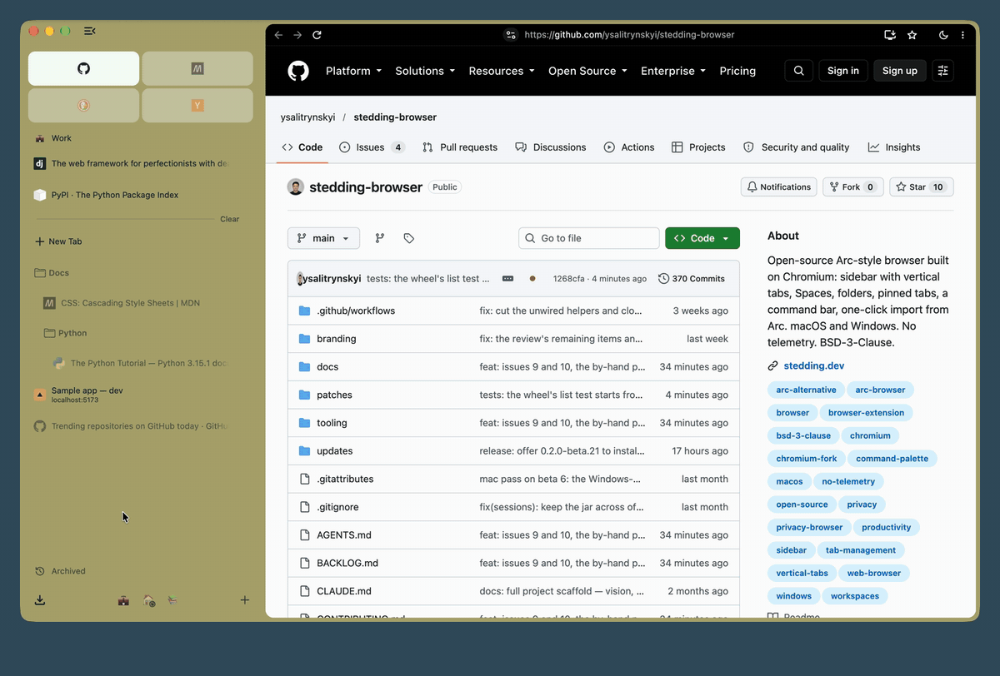
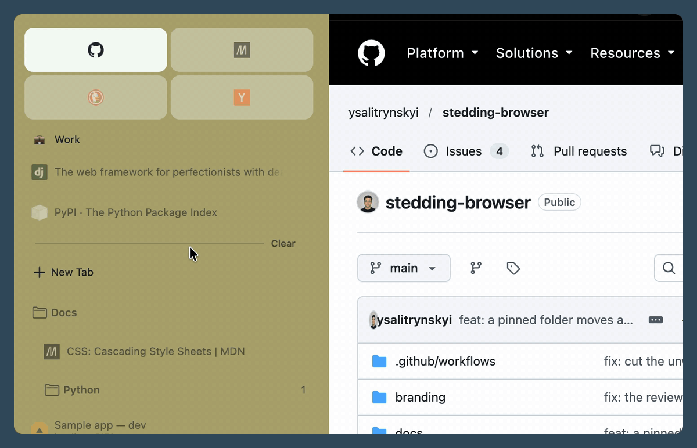
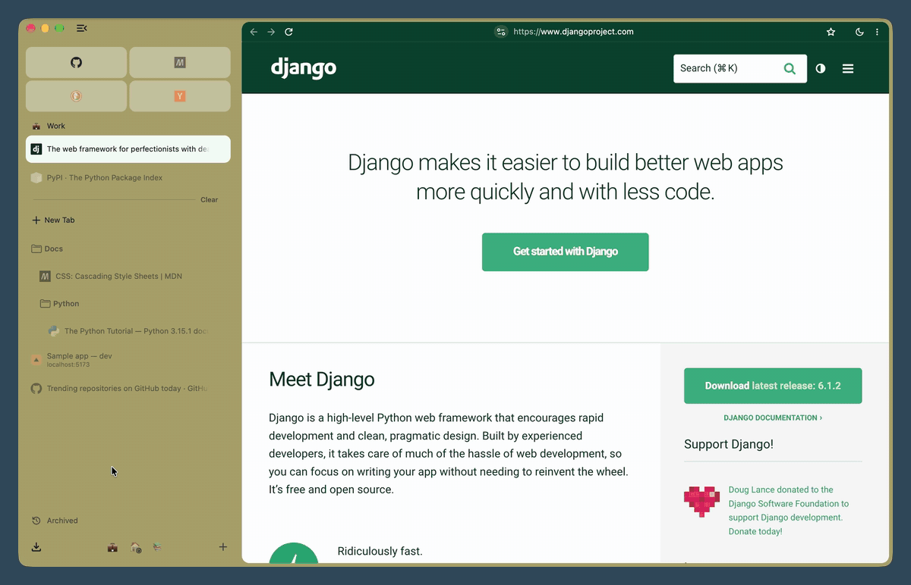
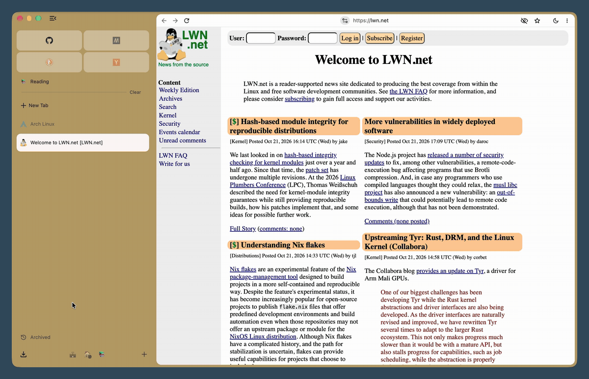
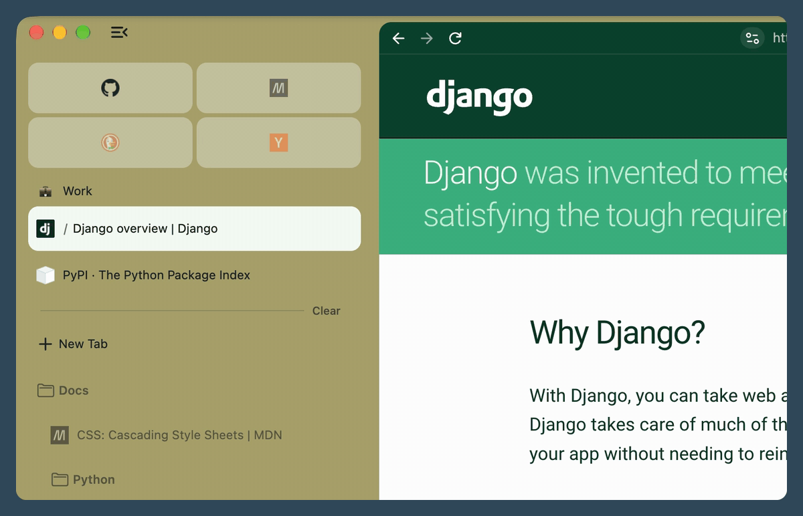
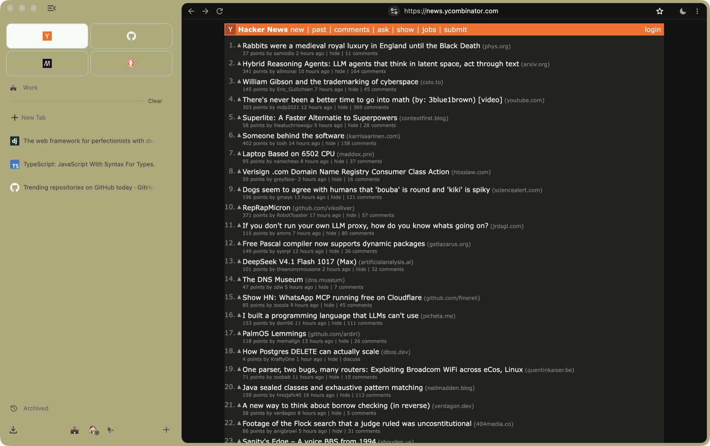
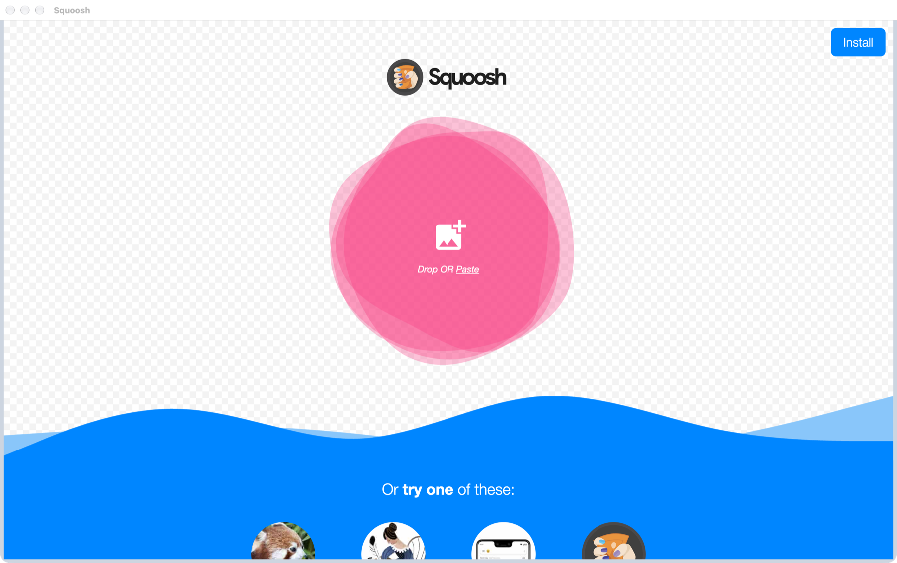
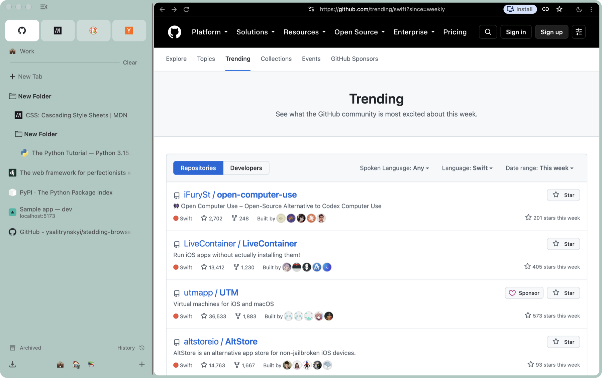

<picture>
  <source media="(prefers-color-scheme: dark)" srcset="branding/public/svg/logo-horizontal-dark.svg">
  
</picture>

# Stedding Browser

**Arc's way of browsing, open source, on Chromium.** Tabs in a sidebar, Spaces, pinned tabs
and folders, and one command bar for everything. macOS (Apple silicon) and Windows. No
account, no telemetry, BSD-3-Clause.

[](https://github.com/ysalitrynskyi/stedding-browser/releases)
[](LICENSE)


[stedding.dev](https://stedding.dev) · [Download](#download) · [Shortcuts](docs/SHORTCUTS.md) ·
[FAQ](docs/FAQ.md) · [Privacy](docs/PRIVACY.md) · [Build](#building-from-source)



## New in 0.3

<table>
  <tr>
    <td width="50%"><br>
      <b>Folders in the pinned tabs.</b> Drag one over the line, to any place among the pins; a bar shows where it will land.</td>
    <td width="50%"><br>
      <b>Spaces with the mouse.</b> Scroll sideways over the sidebar, with a tilt wheel or Shift and the wheel: one Space for each notch.</td>
  </tr>
  <tr>
    <td><br>
      <b>Little windows, then a tab</b>. A link from another app opens small, its row in the page's colour; <b>Open in Stedding</b> (⌘O) moves it into a tab.</td>
    <td><br>
      <b>⌘W on a pinned tab</b>, as in Arc: it goes back to its pinned page, asleep, in its place.</td>
  </tr>
</table>

The rest is in the [release notes](docs/release-notes/archive.md#stedding-030-beta-1).

## What Arc never had

1. **Open source, with no account.** Stedding is BSD-licensed and asks you to sign up for
   nothing: download it and use it. Arc needed an account before it would open, and its code
   is closed.
2. **Spaces with their own sign-ins, in one profile.** Give a Space an Independent session and
   it keeps its own cookies and site data, so the same site can be signed in as work in one
   Space and as you in another. Extensions, settings, history and saved passwords stay shared.
   Arc keeps sign-ins apart only by giving a Space a whole separate profile.
   [Spec](docs/features/sessions.md)
3. **Dark pages.** One switch turns every website dark from its first frame, with no white
   flash: the moon by the address row, or ⌥⇧⌘D (Ctrl+Alt+Shift+D). Keep some sites light, or
   darken only the ones you list. [Spec](docs/features/dark-pages.md)
4. **Apps from any page.** Add to Dock on the Mac, Install page as app on Windows: the page
   gets a window and an icon of its own and keeps the session of the Space it was made in, so
   it stays signed in as that Space is. Arc does not install web apps.
   [Spec](docs/features/web-apps.md)
5. **Site cleanup in one step.** Clear Site Cookies and Reload (⌥⇧⌘R) signs you out of the
   site in front of you and nothing else; Close Duplicate Tabs is one command away.
   [Spec](docs/features/commandbar.md)
6. **Your sidebar on every computer, with no server.** Pick a folder that syncs (iCloud
   Drive, OneDrive, a network share) and each Stedding keeps its Spaces, pins and folders
   there. [Spec](docs/features/sidebar-file.md)
7. **Links without trackers, and blocking if you want it.** `utm_` and similar parameters
   come off the links you open; ad and tracker blocking is built in, off until you turn it
   on. [Spec](docs/features/clean-links.md), [Spec](docs/features/blocker.md)

Dark pages, apps from pages and local development tabs came with 0.2.0 beta 18 on Windows and
with 0.2.0 beta 20 on the Mac.

<p>
  
  
</p>

## Everything you know from Arc

- **The sidebar**: vertical tabs at Arc's proportions, essentials as cards, pinned tabs that
  remember their page and go back to it when you close them, nested folders, in the pinned
  tabs too, and ⌘S to fold it to a rail of icons or hide it.
- **Spaces** with their own colour and icon: switch with the chips, ⌃1–⌃9, a two-finger
  swipe, or the mouse's sideways scroll over the sidebar. A Space can keep its own cookies,
  so one site can be signed into twice.
- **⌘T for everything**: a URL, a search, or any open or archived tab in any Space; ⇧⌘P lists
  every command with its key.
- **Split view**: drag a tab onto the page, and it opens beside it.
- **Peek**: a link from a pinned tab that leaves its site opens over the window; keep it as a
  tab or beside the pin. On a click, or only on a held press, as you choose.
- **History and Downloads in the sidebar**, the sidebar on the left or the right, and
  **shortcuts you can change**.
- **Little windows** for links from other apps, with **Open in Stedding** to keep the
  page as a tab; sites **routed** to their Space, **sleeping tabs**, and an **archive** for
  idle tabs, off until you choose.
- **Local development tabs** marked with Arc's dashed tape, with host and port.
- **Copy the link** clean of trackers (⇧⌘C) or as Markdown, **screenshots** by key, mute and
  picture in picture by key.
- **Arc in one click**: Spaces, essentials, pins, folders, tabs, history and passwords, on the
  Mac and on Windows.
- **Arc's keyboard** on both platforms, and **updates** in the sidebar: signed, looked for at
  launch and every six hours, with a switch to turn them off.

Each feature has a specification naming the test behind every behaviour:
[docs/features/](docs/features/).

## What Arc has that Stedding does not, yet

- **Peek**, a link from a pinned tab over the window: off until it is rebuilt (`S-93`).
- **Boosts and Easels**: deferred ([ADR 0012](docs/decisions/0012-defer-boosts-and-easels.md)).
- **The mini player** in the sidebar: planned; picture in picture by key until then (`S-95`).
- **The Library panel and Live Folders**: later (`S-61`).
- **Sync and sharing**: there is no account, by design. A Space moves between machines as a file.
- **AI (Arc Max)**: never, by choice ([ADR 0020](docs/decisions/0020-no-bundled-model.md)).
- **Phones** (Arc Search): not planned.

## Download

From [stedding.dev](https://stedding.dev/#download) or the
[Releases page](https://github.com/ysalitrynskyi/stedding-browser/releases). The newest release
is **0.3.0 beta 16**, for macOS and Windows, on Chromium 156.0.8078.48.

| Platform | File | |
|---|---|---|
| macOS 13 or later, Apple silicon | `Stedding-<version>-arm64.dmg` | Signed and notarized: drag it to Applications and open it |
| Windows 10 / 11, x64 | `Stedding-<version>-win-x64.exe` | Installs for the current user, no administrator prompt. Not signed yet: SmartScreen → **More info** → **Run anyway**, once |

On a Mac, Homebrew installs it too:

```bash
brew install --cask ysalitrynskyi/stedding/stedding
```

After that it updates itself (the Mac from 0.2.0 beta 16, Windows from 0.2.0 beta 19; an older
Windows copy needs one install by hand). Checksums are in each release's notes;
[docs/INSTALL.md](docs/INSTALL.md) covers verifying, updating and uninstalling. Intel Macs and Linux are not supported yet.

<picture>
  <source media="(prefers-color-scheme: dark)" srcset="docs/images/readme/hero-dark.png">
  
</picture>

## Keyboard shortcuts

The ones you will use most. All of them: [docs/SHORTCUTS.md](docs/SHORTCUTS.md), or
Settings → Stedding → Shortcuts in the browser.

| Action | macOS | Windows |
|---|---|---|
| Command bar: search, a URL, any tab | ⌘T | Ctrl+T |
| Every command, with its key | ⇧⌘P | Ctrl+Shift+P |
| Fold or show the sidebar | ⌘S | Ctrl+S |
| Pin the tab in its Space | ⌘D | Ctrl+D |
| Space 1–9 / next / previous | ⌃1–⌃9 / ⌥⌘→ / ⌥⌘← | Alt+1–9 / Ctrl+Alt+→ / ← |
| Most recent tab | ⌃⇥ | Ctrl+Tab |
| Clear the Space's loose tabs | ⇧⌘K | Ctrl+Shift+K |
| Split the tab with a new one | ⌃⌘N | Alt+Shift+N |
| Dark pages on or off | ⌥⇧⌘D | Ctrl+Alt+Shift+D |
| Copy the link, clean | ⇧⌘C | Ctrl+Shift+C |

## Moving from Arc

With Arc installed, the first start offers **Move everything from Arc**: Spaces with
their colours and icons, essentials, pinned tabs, nested folders, open tabs, history and
passwords. It reads Arc's files on your disk and sends nothing anywhere; on a Mac the passwords
need one keychain prompt, on Windows none, and running it again never duplicates anything. From
Safari or Firefox, Chromium's own importer runs in the same step. On Windows it is new in 0.3.0
beta 13.

## Privacy

- **No telemetry, no experiments, no account.** No usage metrics, crash reports or
  identifiers; the new tab page makes no requests.
- **Protective defaults**: third-party cookies blocked, HTTPS-First, Global Privacy Control,
  quiet permission prompts, search suggestions off, DuckDuckGo until you choose an engine.
- **No Google surfaces**: no sign-in and no AI sections in Settings.
- **Safe Browsing does not protect you** in these builds: its lists need a Google API key the
  builds do not carry (`S-75`).

Every connection the browser makes is listed in [docs/PRIVACY.md](docs/PRIVACY.md).

## Status

An early **beta**, fixed release by release. Known limits: the Windows installer is unsigned
(`S-56`); Safe Browsing is off (above); on a Mac with a second desktop, Mission Control takes
⌃1–⌃9 (the Spaces menu keeps them); while Arc runs it takes ⌥⌘N from every app (`S-79`;
[the FAQ](docs/FAQ.md) has the way round); Netflix, Disney+ and Spotify's web player do not
play, since Widevine is not built yet (`S-270`). Open work is in [BACKLOG.md](BACKLOG.md), the
milestones in [docs/ROADMAP.md](docs/ROADMAP.md), and every release's changes in
[docs/release-notes/](docs/release-notes/).

## Building from source

Stedding is a documented patch series on Chromium stable. The macOS build needs Apple silicon,
about 150 GB free and a few hours the first time:

```bash
tooling/bootstrap-depot-tools     # once per machine
tooling/sync-chromium             # once per pin change; tens of GB
tooling/apply-patches             # the Stedding patch series
tooling/apply-branding            # the name and the icon
tooling/build-chromium release --budget 0
tooling/package-dmg release
```

On Windows, `tooling/win/build.ps1` and `tooling/win/package-installer.ps1` build the same
series. Prerequisites and build times: [docs/ARCHITECTURE.md](docs/ARCHITECTURE.md).

## Contributing

The most useful thing now is a report from real use: install the latest beta, use it for a
day, and open an issue for each thing that is worse than what you use today. See
[CONTRIBUTING.md](CONTRIBUTING.md); security issues go through private reporting
([SECURITY.md](SECURITY.md)). A pull request made with an AI tool's help says so, and each of
its commits carries an `Assisted-by:` trailer ([CONTRIBUTING.md, "AI tools"](CONTRIBUTING.md#ai-tools)).
New contributors and agents start at [AGENTS.md](AGENTS.md); the index of every document is
[docs/README.md](docs/README.md).

## License

[BSD-3-Clause](LICENSE). Chromium is © The Chromium Authors, BSD-3-Clause.
